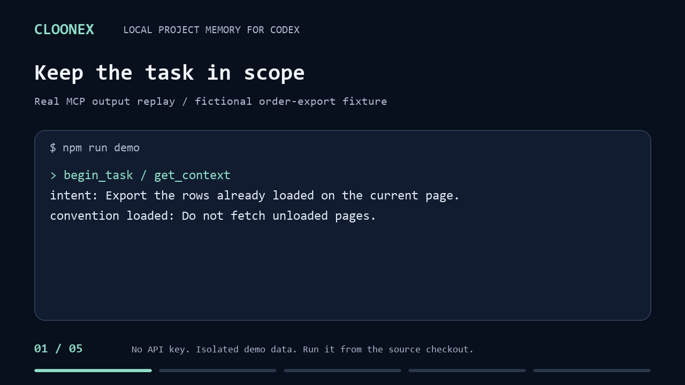

# Cloonex

**Local project memory for AI coding tools, through MCP. Keep the intent. Recover the reason. Check what changed.**

English · [简体中文](README.zh-CN.md)

[](https://github.com/sywliushaocheng/cloonex/actions/workflows/ci.yml)
[](LICENSE)
[](package.json)

A new AI session can read the code, but the reasons behind it may be missing. Cloonex stores task intent, project conventions, decisions and verified feature notes in a local SQLite database, and makes them available through MCP.

Cloonex is a standard **MCP server over stdio**, with no Codex-only client check. AI applications that can launch local stdio MCP servers can configure it. **Codex is the currently verified client**, and the bundled config generator and skill installer target Codex; other clients have not been individually validated. No Cloonex account, hosted backend or always-running daemon is required. [Client setup guide →](docs/mcp-clients.md)

## See it work

**New in 0.2.0:** portable history backups, live evidence checks, re-review baselines, explicit record replacement, unified search and project diagnostics. [Release notes](docs/releases/v0.2.0.md).



*Selected output from real MCP calls against a fictional order-export fixture. This is an output replay, not a recording of a model conversation. [Text version](docs/assets/demo-transcript.json) · [Static image](docs/assets/demo.png).*

Try the same workflow without a Codex account or API key:

```bash
# After cloning and running npm ci:
npm run demo
```

The demo starts two separate MCP processes against the same temporary database, retrieves the saved decision, edits a linked source file and checks for stale notes. It leaves your own knowledge base untouched. [Full walkthrough →](docs/example.md)

## What it helps with

| When you need to… | Cloonex provides… |
|---|---|
| Keep a task within scope | Intent, constraints, exclusions and completion criteria |
| Continue in another session | Project conventions and applicable confirmed preferences |
| Explain an old implementation | Feature notes, decisions and explicitly recorded reasons |
| Check whether a note needs review | On-demand fingerprints of linked source files |
| Hand a task to someone else | A Markdown context export |

Cloonex is a structured knowledge store, not automatic conversation capture. Your agent must use the tools or the included skill. File fingerprints detect content changes, not semantic changes, and do not prove an explanation is correct.

## Quick start

Requires **Node.js ≥ 20.11 and npm**. You do **not** need Git, a source checkout or a local TypeScript build. Install the prebuilt release package directly:

```bash
npm install --global "https://github.com/sywliushaocheng/cloonex/releases/download/v0.2.0/cloonex-0.2.0.tgz"
cloonex init
```

The package contains precompiled JavaScript from the `v0.2.0` source tag; npm installs its runtime dependencies automatically. Network access to GitHub/npm is required. Use the named `.tgz` asset, not GitHub's source-code ZIP or tar archive. [Release and SHA-256 checksum](https://github.com/sywliushaocheng/cloonex/releases/tag/v0.2.0). The npm registry package has not been published, so use the full URL above rather than `npm install -g cloonex` or `npx cloonex`.

Then configure your AI application using the [MCP client setup guide](docs/mcp-clients.md). For **Codex**, the bundled helpers are:

```bash
cloonex mcp-config --direct
cloonex install-skill
```

1. Add the generated MCP configuration to your Codex config, usually `~/.codex/config.toml` (or the config under `CODEX_HOME` when set).
2. Reload the client as needed so it discovers the MCP server and skill, and review/trust the server in your client.
3. Open a project and ask: **“Use the Cloonex workflow for this task. Read the project context first, preserve the agreed scope and record only facts you verify.”**

`--direct` uses your installed Node and CLI paths. Regenerate the configuration after moving the installation or switching machines. If `cloonex` is not found, make sure npm's global executables directory is on your PATH and reopen the terminal. From a source checkout, you can also run `node dist/src/cli.js <command>`.

SQLite runs through WebAssembly, so no local C/C++ toolchain is needed. The default data directory is `~/.cloonex`; use `cloonex init --data-dir <directory>` to choose another. Program updates and personal data are separate.

To reinstall this version, run the same `npm install --global` command. Before upgrading an existing installation, pause clients and keep a backup of the data directory. The additive schema upgrade preserves existing records; older binaries must not be used on the upgraded library. Regenerate client configuration if paths change and reinstall the Codex skill if you use it.

## Keep your history when moving computers

On the old computer, with 0.2.0 installed:

```bash
cloonex backup export --out "history.cloonex.gz"
```

Transfer the archive yourself. On the new computer, import directly into a fresh directory without running `init` first:

```bash
cloonex backup inspect "history.cloonex.gz"
cloonex backup import "history.cloonex.gz" --data-dir "/absolute/path/to/CloonexData"
cloonex doctor
cloonex mcp-config --format json
```

All historical IDs, task/feature relationships, decisions, preferences, evidence and exported handovers are retained. Existing data is never overwritten or merged. Source repositories and client settings are separate; use `project-move` if repository paths changed. Backups are checksummed, not encrypted. [Complete migration guide →](docs/migration.md)

## Supported connection and client workflow

The service launches with `cloonex mcp` or `node /absolute/path/to/dist/src/cli.js mcp`. Use `cloonex mcp-config --format json` for a common JSON envelope, `--format connection` for raw launch values, or the default Codex TOML. These commands use installed local paths and work before initialization. The [setup guide](docs/mcp-clients.md) explains the remaining client-specific differences.

The current transport is **local stdio**, not HTTP/SSE. A client that accepts only remote MCP URLs cannot connect directly. Reading and fingerprinting project files also requires the server process to have access to those local paths. Protocol compatibility does not establish that every client's model will follow the workflow correctly.

## A concrete example

Suppose an export should use only the orders already loaded on one page. The workflow stores that scope and the supported reason for it. A later MCP process can retrieve both. If the linked file changes, an explicit stale check reports that the note needs review.

```text
begin_task → get_context → record_decision → finalize_task
                               ↓
                    query_feature + stale_check
```

Run `npm run demo` or follow the [complete example](docs/example.md), including prompts for using it in your own project. In 0.2.0, feature retrieval and task context check linked evidence on demand; `stale_check` remains available for a project-wide report. There is no background watcher.

## Learning boundaries

These boundaries are enforced by server-side policy guards.

| Task type | Read context | Feature notes | Decisions | Learn preferences |
|---|---|---|---|---|
| New feature / refactor | Yes | Yes | Yes | Candidate by default |
| Bug fix | Yes | No | No | No |
| Query / documentation | Yes | Checked notes only | No | No |
| Unknown | Yes | No | No | No |

Unconfirmed preferences do not enter task context as constraints. Confirmed preferences are selected by global, project, stack or scene scope. Revoked rules stop applying. Missing reasons stay unknown; the model should not invent them.

## Useful commands

```bash
cloonex info --detail          # Data location and record counts
cloonex projects               # Registered projects
cloonex tasks <project-path>   # Task history
cloonex show <task-id>         # Task context
cloonex export <task-id>       # Markdown handover
cloonex stale <project-path>   # Check linked-file fingerprints
cloonex preferences            # Preference candidates and confirmed rules
cloonex preference-revoke <id> # Stop using a rule
cloonex search "order export" # Search tasks, features, decisions and notes
cloonex doctor --check-files   # Check project paths, evidence and open tasks
cloonex project-move <id> <new-path> # Relink an existing project
cloonex rules <project-path>   # Preview a rule file; --apply imports it
cloonex labels                # Inspect scene/stack tags and explicit aliases
```

## Status and limits

This is an **early integration prototype**. The automated suite covers domain rules and real MCP stdio transport; the runnable demo also checks retrieval across two server processes. Windows has local validation records. CI is configured for Windows and Linux with Node 20, 22 and 24; check the workflow results for current status. macOS has not been validated on hardware.

- Search uses local words/phrases and aliases across record types. Staleness checks only cover explicitly linked evidence and do not infer semantics.
- SQLite uses a WASM build without WAL; concurrent multi-process writes are not validated.
- No GUI, cloud sync, team collaboration or background conversation capture.
- No measured claims about model quality, token savings or cross-model consistency.
- Records stay local by default. Material selected for a cloud model's context is still sent to that model service. SQLite data is not encrypted by Cloonex.

See the [validation notes (中文)](docs/验收状态.md) and [distribution guide (中文)](docs/分享指南.md).

## Development and feedback

Git is needed only if you want to clone the repository to inspect the source, run the demo or contribute:

```bash
git clone https://github.com/sywliushaocheng/cloonex.git
cd cloonex
npm ci
npm run verify          # Typecheck, build and automated tests
npm run demo            # Real MCP workflow in an isolated temporary project
npm pack --dry-run      # Inspect distributable files
```

For CLI access from this checkout, run `npm install --global .` or use `node dist/src/cli.js <command>` after the build.

[Report a bug](https://github.com/sywliushaocheng/cloonex/issues/new/choose), suggest a use case or send a focused pull request. English and Chinese are welcome. [Contributing guide](CONTRIBUTING.md).

If you try it, tell us where setup failed, whether a later session recovered useful context, or which returned records were unhelpful. Please remove secrets and private knowledge-base content from reports.

## License

[MIT](LICENSE)
