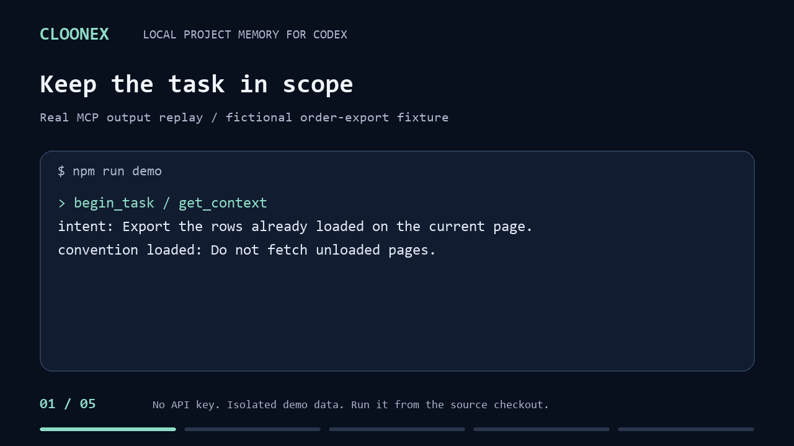

# Cloonex

**通过 MCP 为 AI 编程工具提供可追溯的本地项目知识库：记住开发要求、找回关键决定、检查关联代码是否变化。**

[English](README.md) · 简体中文

[](https://github.com/sywliushaocheng/cloonex/actions/workflows/ci.yml)
[](LICENSE)

在借助 AI 开发的同时，保存**开发意图、项目约定、关键决定和功能说明**，便于新会话继续使用。服务端采用标准 **MCP stdio**，没有限制客户端必须是 Codex；支持启动本地 stdio MCP 服务的 AI 软件可以配置接入。

**当前已实测客户端是 Codex**，附带的配置生成和技能安装命令也优先适配 Codex；其他客户端尚未逐一实测。服务按需启动，不常驻后台、不需要 Cloonex 账号。参见[通用客户端配置指南](docs/mcp-clients.md#中文说明)。

## 先看演示



这是虚构订单导出案例的真实调用结果回放，不是模型聊天录屏。[文字回放](docs/assets/demo-transcript.json) · [完整案例](docs/example.zh-CN.md)

克隆源码并安装依赖后，直接执行：

```bash
npm run demo
```

无需 API Key 或 Codex 登录。脚本会使用隔离的临时项目与数据库，启动两次真实 MCP 服务验证记录能否找回，并显式执行过时检查，不读取现有个人知识库。

## 它解决什么

| 问题 | Cloonex 的做法 |
|---|---|
| AI 开发偏离原意 | 任务开始先明确目标、范围与完成条件，结束后逐项核对 |
| 新会话需要重新说明约定 | 项目约定与决定保存在本地，经 MCP 按任务提供；其他客户端尚未验证 |
| 产出“AI 味”重 | 记录认可与不认可的实例，按场景限定偏好适用范围 |
| 迭代一两年后忘了功能逻辑 | 功能档案区分当前说明与历史决定，代码变化后提示复核 |
| 经验散落在对话里 | 关键决定与理由结构化保存，可检索、可导出 |

## 快速开始

需要 Node.js ≥ 20.11 和 Git。首次使用请从本仓库安装；GitHub 开源与 npm 发布是独立步骤。

```bash
# 1. 获取源码并安装（prepare 脚本会自动编译）
git clone https://github.com/sywliushaocheng/cloonex.git
cd cloonex
npm ci
npm install --global .

# 2. 初始化个人数据目录（默认 ~/.cloonex）
cloonex init
```

接下来按[客户端配置指南](docs/mcp-clients.md#中文说明)配置所用 AI 软件。**Codex 用户**可继续执行：

```bash

# 3. 输出本地安装的 Codex 接入配置，按提示加入 config.toml
cloonex mcp-config --direct

# 4. 安装 Codex 开发流程技能
cloonex install-skill
```

SQLite 使用纯 WASM 版本，**不需要本地 C/C++ 编译工具链**。如需指定数据目录，可执行 `cloonex init --data-dir <目录>`。

配置写入 Codex 后，需要在 Codex 中审阅并信任该 MCP 服务。之后在项目里说“开始一个新功能任务”即可走完整流程。

可以直接说：“使用 Cloonex 流程处理本次任务，先读取项目上下文，保持约定范围，只保存实际核对过的说明。”客户端需要按需重新加载以发现服务与技能。Cloonex 不会自动采集全部聊天，模型需要调用工具或使用附带技能。

## 接入配置示例

下面是 **Codex TOML** 格式。`cloonex mcp-config --direct` 会输出当前机器的 Node 和程序路径；其他客户端使用同样的启动参数，按各自格式填写（参见[通用 JSON 示例](docs/mcp-clients.md)）：

```toml
[mcp_servers.cloonex]
command = '/absolute/path/to/node'
args = ['/absolute/path/to/cloonex/dist/src/cli.js', 'mcp']

[mcp_servers.cloonex.env]
CLOONEX_DATA_DIR = '/absolute/path/to/cloonex-data'
```

以上是占位示例，请使用命令生成的真实路径；移动程序或更换机器后需重新生成配置。

`CLOONEX_DATA_DIR` 是**个人数据目录**，与程序安装位置完全独立。程序升级或重装不会清除数据。

## 使用流程

```
begin_task → get_context → (开发) → record_decision / save_checkpoint → finalize_task → propose_preference
```

- **begin_task**：确定任务类型。类型决定学习边界，由服务端强制执行。
- **get_context**：读取项目约定、适用偏好、关联功能与关键决定。
- **record_decision**：记录方案与理由。`reasonSource` 必须真实，模型不得编造用户动机。
- **finalize_task**：写入已核对的功能说明，并记录代码指纹用于过时检测。
- **propose_preference**：默认写入候选偏好，只有用户明确要求长期采用才确认。

## 学习边界（硬性）

| 任务类型 | 读取已有约定 | 写入功能/决定 | 学习偏好 |
|---|---|---|---|
| 新功能开发 | 是 | 是 | 是 |
| 功能重构 | 是 | 是 | 是 |
| Bug 修复 | 是 | **否** | **否** |
| 查询与梳理 | 是 | 仅可保存核对过的说明 | 否 |
| 类型不明确 | 是 | 否 | 否 |

这些规则在 `src/domain/policy.ts` 中定义，并在写入前由 `assertCan*` 守卫执行。**不依赖提示词自觉遵守**：Bug 修复任务即使调用写入工具也会被拒绝。

## 关键设计

**事实、理由、推测分开保存。** 代码能证明行为，记录能证明当时的决定；没有证据的原因标为 `unknown`，系统不会事后补写动机。

**当前说明与历史决定分开。** 修改功能说明时旧版本标记为历史并保留关联，因此可以回答“现在怎么实现”和“当初为什么这样做”。

**按需核对，不后台扫描。** 功能说明关联文件指纹，查询或开发时按需比对，代码变化后提示复核。

查询功能和过时检查需要分别调用。文件内容变化（包括仅修改注释）也会触发提示；它不判断语义差异，也不自动改写功能说明。

**候选偏好不等于约束。** 候选规则可被检索，但不会注入任务上下文；只有已确认的规则才作为约束。

## CLI

```bash
cloonex info --detail          # 数据位置与记录数量
cloonex projects               # 已注册项目
cloonex project <路径>         # 项目约定与功能档案
cloonex tasks <路径>           # 任务历史
cloonex show <任务ID>          # 任务上下文
cloonex export <任务ID>        # 导出交接 Markdown
cloonex stale <路径>           # 检查记录与代码是否不一致
cloonex preferences            # 偏好列表
cloonex preference-revoke <ID> # 撤销偏好
cloonex mcp-config --direct    # 输出本地安装的接入配置
cloonex install-skill          # 安装开发流程技能
```

## 技术选型说明

- **TypeScript / Node.js（≥ 20.11）**，通过 npm 分发。
- **SQLite 使用 `node-sqlite3-wasm`**：纯 WebAssembly，无需本地编译，Windows 与 macOS 安装时不需要工具链。
  - 开发中实测 `better-sqlite3` 的原生预编译二进制在本机会导致解释器崩溃（0xC0000005），因此改用 WASM 版本。
  - 该构建的 SQLite 为 3.53，`journal_mode` 为 `delete`（不支持 WAL）。MCP 服务每个进程使用单一连接，写入已串行化。
- **不收集数据**：无账号、无云端服务、无默认遥测。使用云端模型时，被选中的约定与代码材料会进入模型上下文——这与“数据保存在本地”是两件事，不混淆表述。

## 分享给别人

见 [docs/分享指南.md](docs/分享指南.md)。可直接分享本仓库地址，或执行 `npm pack` 后分发生成的安装包。

## 开发

```bash
npm install         # prepare 脚本会自动编译
npm run typecheck   # 类型检查
npm test            # 构建并运行测试
npm run build       # 编译到 dist/
```

测试覆盖：

- `test/core.test.ts`：领域逻辑，含学习边界、偏好生命周期、过时检测、历史保留。
- `test/idempotency.test.ts`：重复结束任务与说明去重。
- `test/scene.test.ts`：场景、技术栈偏好隔离及旧数据库迁移。
- `test/mcp.test.ts`：通过真实 stdio 传输启动 MCP 服务，按 Codex 的调用方式验证完整闭环。

## 当前状态

已完成**接入原型**阶段：Codex 能够读取约定、写入决定与功能说明、查询旧功能，失败可见；Bug 修复任务不产生学习记录；代码变化后过时检测生效。

尚未实现：图形界面、跨模型适配、后台事件钩子、设计图解析、团队协作。详见 `docs/验收状态.md`。

Windows 有本地验证记录；CI 配置覆盖 Windows/Linux 和 Node 20、22、24，实际结果以工作流为准。macOS 实机和多进程并发写入尚未验证，没有量化证明模型效果提升或 Token 节省。

## 反馈与贡献

欢迎通过 [Issues](https://github.com/sywliushaocheng/cloonex/issues) 报告问题或提出建议，也欢迎提交 Pull Request。提交前请运行 `npm run verify`；问题报告请说明 Node.js 版本、操作系统和复现步骤，避免附带密钥或个人知识库数据。

支持中英文反馈，参见[贡献指南](CONTRIBUTING.md)。尤其欢迎反馈安装卡在哪一步、新会话是否找回了有用的上下文，以及哪些记录帮助不大。

## 许可证

本项目采用 [MIT License](LICENSE)。
